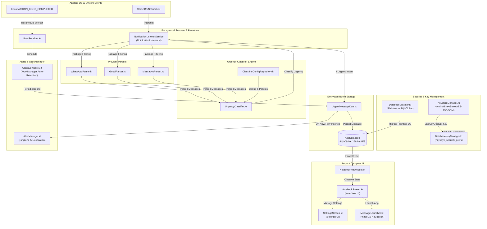

# 🏗️ Haykeye Architecture & System Design

Haykeye follows a reactive, local-first architecture built with modern Android development practices, Jetpack Compose, Room, SQLCipher, and Kotlin Coroutines.

---

## 📐 System Architecture Diagram

---

## 🧩 Component Responsibilities

### 1. Notification Listener (`NotificationListener.kt`)
- Extends `NotificationListenerService`.
- Filters notifications from supported packages (`com.whatsapp`, `com.whatsapp.w4b`, `com.google.android.gm`, `com.google.android.apps.messaging`).
- Tracks connection lifecycle (`onListenerConnected()`, `onListenerDisconnected()`, `requestRebind()`).

### 2. Provider Parsers (`WhatsAppParser`, `GmailParser`, `MessagesParser`)
- **`WhatsAppParser.kt`**: Extracts sender names, group names, timestamps, and message text from `MessagingStyle` notifications. Ignores batch group summary notifications.
- **`GmailParser.kt`**: Extracts email senders, subjects, and previews, gracefully fallback-handling subjectless emails.
- **`MessagesParser.kt`**: Extracts SMS/MMS/RCS text messages from Google Messages.

### 3. Urgency Classifier (`UrgencyClassifier.kt`)
- Pure, stateless classification engine.
- Evaluates urgency against **Default Multilingual Keywords** (English, Bengali, Hindi, Banglish, Hinglish) using word boundary regex (`\b`).
- Checks provider-scoped VIP Senders, VIP Groups, `@mention` metadata, text heuristics (`!!` & 70%+ uppercase text), and Per-Group Noise Control policies.

### 4. Security & Encryption (`com.soumyadip.haykeye.security`)
- **`KeystoreManager.kt`**: Generates a 256-bit AES master key in `AndroidKeyStore` and performs hardware-backed encryption/decryption.
- **`DatabaseKeyManager.kt`**: Generates a 256-bit `SecureRandom` passphrase, encrypts it via `KeystoreManager`, and stores the ciphertext in private app preferences.
- **`DatabaseMigrator.kt`**: Automatically migrates legacy plaintext databases into SQLCipher encrypted databases using `sqlcipher_export`.

### 5. Source App Navigation (`MessageLauncher.kt`)
- Implements 3-tier navigation priority:
  1. **Priority 1 (Active Notification Action):** Invokes `pendingIntent.send(context, 0, null)` from `Activity` context to open exact chat/email thread.
  2. **Priority 2 (Contact Phone Mapping / Deep Links):** Uses `ContactMappingRepository` or verified phone/email to launch direct chat windows (`whatsapp://`, `smsto:`, `mailto:`).
  3. **Priority 3 (Safe App Fallback):** Launches provider app home screen safely if exact navigation is unavailable.
